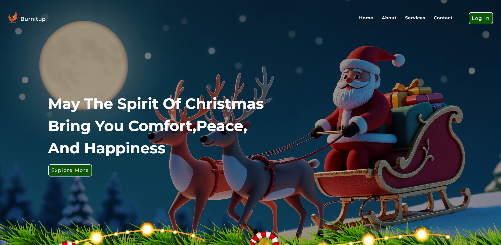
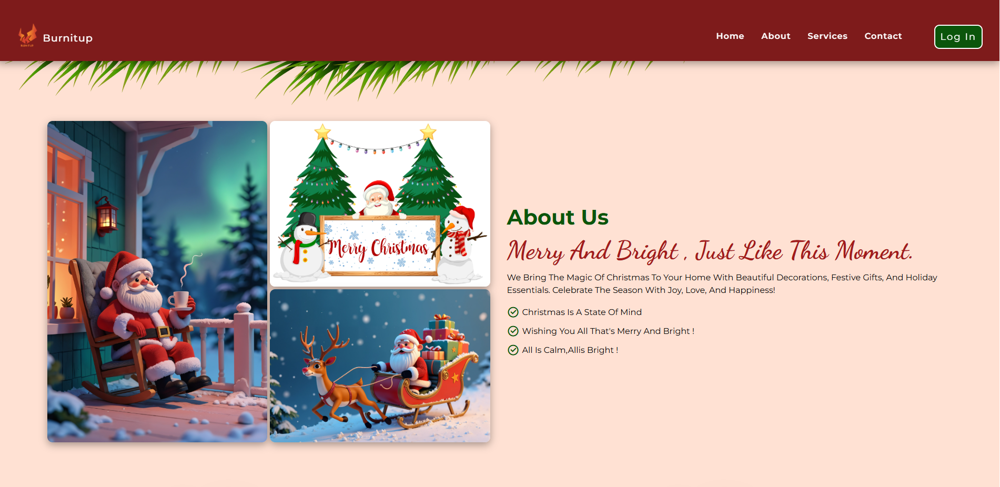
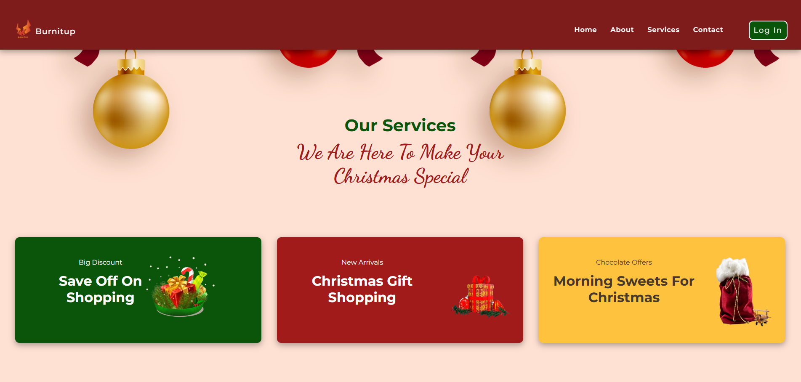
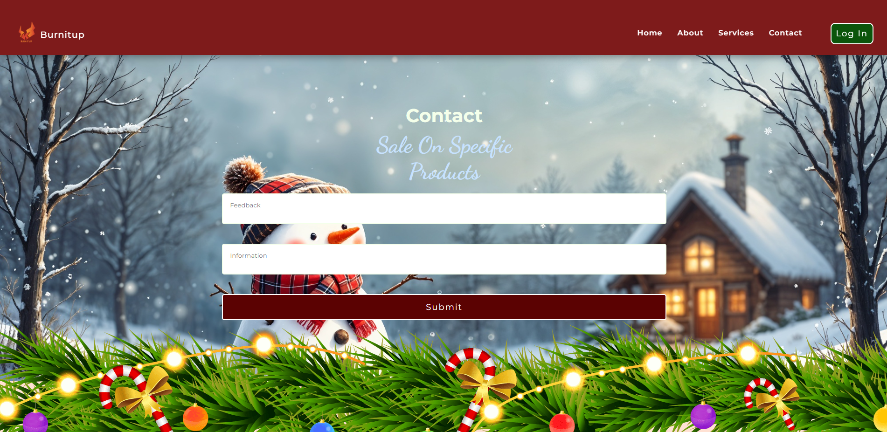
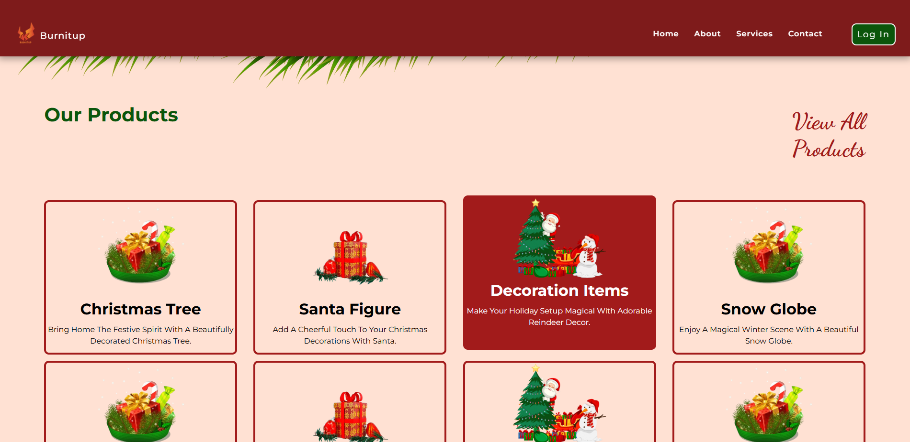
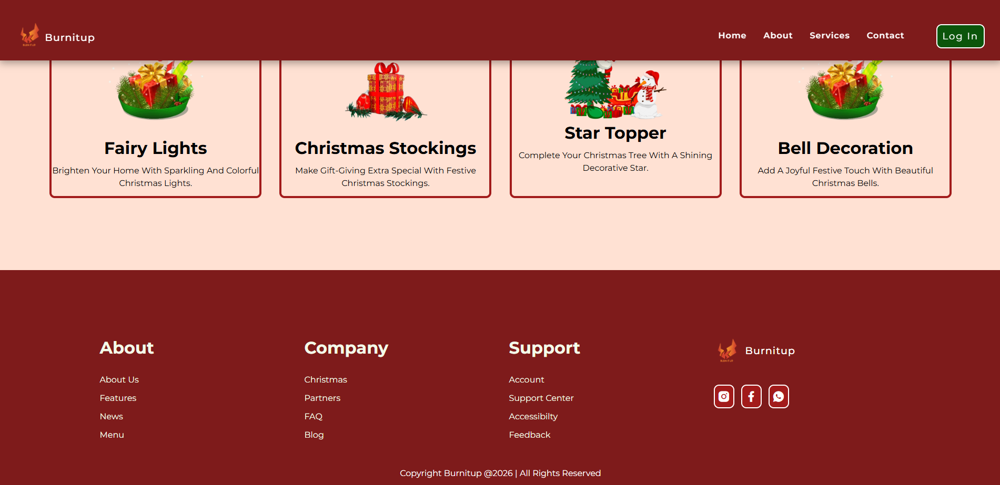

# 🎄 Christmas Website

A festive and responsive Christmas-themed website designed to bring the magic of the holiday season online. Explore beautiful Christmas decorations, discover festive products, and enjoy a delightful holiday experience.

## ✨ Features

- 🏠 **Home** – Attractive Christmas-themed landing page.
- 🎅 **About** – Introduction to the Christmas website.
- 🎨 **Services** – Explore festive services and offerings.
- 📩 **Contact** – Easy-to-access contact section.
- 🎁 **Products** – Showcase of Christmas decorations and products.
- 🔗 **Footer** – Social media links and useful navigation.
- 📱 **Responsive Design** – Optimized for desktop, tablet, and mobile screens.

## 🛠️ Technologies Used

- HTML5
- CSS3
- JavaScript
- Remix Icon

## 📸 Website Screenshots

### 🏠 Home

### 🎄 About

### ✨ Services

### 📩 Contact

### 🎁 Products

### 🔗 Footer

## 🎯 Project Purpose

This project was created to practice and improve frontend development skills, focusing on responsive layouts, CSS styling, JavaScript interactions, and website design.

## 👨‍💻 Author

Vishal Katarha - Creative Technologist & Software Developer

- GitHub: https://github.com/VishalKatarha
- LinkedIn: https://linkedin.com/in/vishalkatarha

⭐ If you like this project, consider giving it a star!